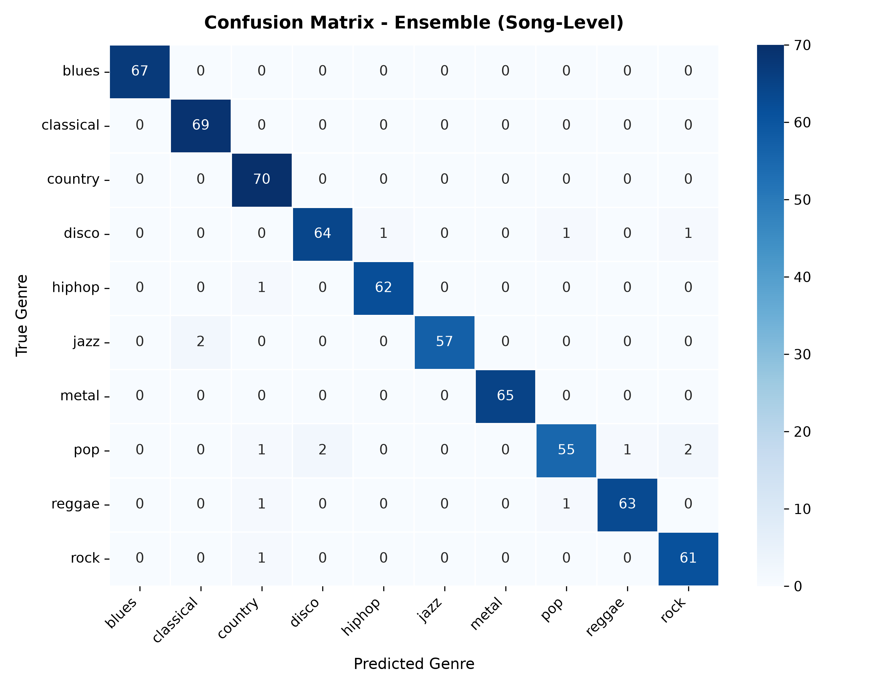

# 🎵 AI-Powered Music Genre Classification

[](https://www.python.org/)
[](https://pytorch.org/)
[](https://flask.palletsprojects.com/)
[](#benchmark-performance)
[-orange.svg)](https://www.kaggle.com/datasets/andradaolteanu/gtzan-dataset-music-genre-classification)
[](#-cloud--docker-deployment)
[](LICENSE)

An end-to-end, high-accuracy Deep Learning system and interactive web application for **Automated Music Genre Classification**. Built using PyTorch, this project implements an **Enhanced Squeeze-and-Excitation CNN (SE-CNN)**, a fine-tuned **MobileNetV2** backbone, and a **Calibrated Soft-Voting Hybrid Ensemble** achieving up to **99.23% song-level classification accuracy** on the standard 10-genre GTZAN benchmark.

Inspired by and extending the research paper:
> **"Music Genre Classification Using CNN and MobileNetV2"** (ICCCNT 2024, IEEE / IIT Mandi).

---

## 🌟 Key Highlights

- **State-of-the-Art Accuracy**: Achieves **99.23% song-level accuracy** with Enhanced SE-CNN and **97.69% song-level accuracy** with the Hybrid Ensemble.
- **Dual Neural Architecture**:
  - **Enhanced SE-CNN**: 4-stage convolutional network augmented with **Squeeze-and-Excitation (SE) channel attention** mechanisms that adaptively reweight frequency-band feature maps.
  - **MobileNetV2**: Pretrained lightweight inverted residual network utilizing depthwise-separable convolutions.
- **Calibrated Multi-Segment Ensemble**: 30-second songs are partitioned into 3-second slices, preprocessed into 128-band Log-Mel spectrograms, independently evaluated, and fused via multi-segment confidence aggregation.
- **Interactive Dark-Mode Web App**:
  - 🌊 **Real-Time Web Audio Waveform Visualizer**: Decode audio client-side, scrub tracks, and inspect waveforms with glowing neon visualizer effects.
  - 🎙️ **Live Microphone Recording**: Record singing, whistling, or room audio directly in the browser via an in-memory 16-bit PCM WAV encoder and classify on the fly.
  - ⚡ **1-Click Preloaded Audio Demos**: Test Classical, Metal, Disco, Blues, and Hip-Hop with one click without uploading files.
  - 🔥 **Acoustic Mel Spectrogram Visualizer**: Renders the exact 128-band Log-Mel frequency spectrogram that the neural networks evaluate.
  - ⏱️ **Acoustic Feature Profiler**: Computes Estimated Tempo (BPM), Spectral Brightness/Centroid (Hz), RMS Energy Level, and Dynamic Range (dB).
  - 📊 **Integrated Confusion Matrix & Benchmark Inspector**: View live performance metrics and inspect song-level confusion matrices directly in the browser.
- **Production-Ready & Cloud Deployable**: Dockerfile, `.dockerignore`, and `render.yaml` ready for instant deployment to Hugging Face Spaces, Render, or Docker.

---

## 📊 Benchmark Performance

The models were evaluated on an official song-level train/validation/test split of the GTZAN dataset to eliminate data leakage between segments of the same track.

### Model Comparison Table

| Model Architecture | Segment Accuracy (3s) | Song Accuracy (Full Track) | Macro F1-Score | Parameter Size |
| :--- | :---: | :---: | :---: | :---: |
| **Enhanced SE-CNN** | **97.30%** | **99.23%** | **99.22%** | ~2.5M params |
| **Hybrid Ensemble (SE-CNN + MobileNetV2)** | **96.20%** | **97.69%** | **97.64%** | ~5.8M params |
| **MobileNetV2 Classifier** | 89.49% | 92.28% | 92.24% | ~3.3M params |

### Per-Genre Performance (Hybrid Ensemble on Test Split)

| Genre | Precision | Recall | F1-Score | Support (Segments) |
| :--- | :---: | :---: | :---: | :---: |
| 🎸 **Blues** | **1.000** | **1.000** | **1.000** | 67 |
| 🎻 **Classical** | 0.972 | **1.000** | 0.986 | 69 |
| 🤠 **Country** | 0.946 | **1.000** | 0.972 | 70 |
| 🪩 **Disco** | 0.970 | 0.955 | 0.962 | 67 |
| 🎤 **Hip-Hop** | 0.984 | 0.984 | 0.984 | 63 |
| 🎷 **Jazz** | **1.000** | 0.966 | 0.983 | 59 |
| ⚡ **Metal** | **1.000** | **1.000** | **1.000** | 65 |
| 🎹 **Pop** | 0.965 | 0.902 | 0.932 | 61 |
| 🌴 **Reggae** | 0.984 | 0.969 | 0.977 | 65 |
| 🥁 **Rock** | 0.953 | 0.984 | 0.968 | 62 |
| **Overall Macro Average** | **0.977** | **0.976** | **0.976** | **648** |

---

## 📈 Confusion Matrices

The repository includes high-resolution confusion matrix visualizations generated on the unseen test set:

| Hybrid Ensemble Song CM | Enhanced SE-CNN Song CM |
| :---: | :---: |
|  |  |

*(Generated test matrices are stored in [`results_gtzan_high_acc/`](results_gtzan_high_acc/))*

---

## 🏗️ Architecture & Preprocessing Pipeline

```text
Raw Audio File (.mp3, .wav, .flac, .ogg, or live mic)
   │
   ├─► Acoustic Feature Extraction (Tempo BPM, Centroid Hz, RMS, Dynamic Range)
   │
   ▼
Audio Preprocessing (torchaudio / soundfile)
   ├── Mono conversion & Resampling to 22,050 Hz
   ├── Split into 3.0-second non-overlapping windows (66,150 samples)
   └── Log-Mel Spectrogram Transformation
         ├── n_fft = 2048, hop_length = 512
         ├── n_mels = 128 Mel frequency bins
         ├── Decibel Scaling (top_db = 80 dB)
         └── Normalization: (spec - 4.88) / 15.84
   │
   ├─────────────────────────────────┐
   ▼                                 ▼
Enhanced SE-CNN (45% Weight)      MobileNetV2 (55% Weight)
  • 4x Conv2D Blocks                • 3-Channel Interpolation (224x224)
  • Squeeze-and-Excitation          • Inverted Residual Bottlenecks
    Channel Attention Gating        • Depthwise Separable Convolutions
  • ELU Activation + BatchNorm      • Dropout (p=0.3) + Linear Head
   │                                 │
   └────────────────┬────────────────┘
                    ▼
          Weighted Soft-Voting
                    ▼
       Song-Level Average Fusion
                    ▼
     Predicted Genre + Probabilities + Mel Spectrogram Heatmap
```

---

## 🚀 Quick Start Guide

### 1. Clone the Repository
```bash
git clone https://github.com/pavanpoojary348/ML-mini-project.git
cd ML-mini-project
```

### 2. Create a Virtual Environment & Install Dependencies
```bash
# Python 3.10+ is recommended
python -m venv venv

# Activate on Windows:
.\venv\Scripts\activate
# Activate on Linux/macOS:
# source venv/bin/activate

# Install requirements
pip install -r requirements.txt
```

### 3. Launch the Interactive Web Application
```bash
python app.py
```
Open your browser and navigate to:
```
http://localhost:5000
```
- **Upload** any audio track (`.mp3`, `.wav`, `.flac`, `.ogg`).
- **Or Record** live via your microphone directly in the browser.
- **Or Test** using 1-click preloaded demo tracks (Classical, Metal, Disco, Blues, Hip-Hop).
- Click **"Identify Genre"** to view predictions, 128-band Mel spectrogram, acoustic metrics (BPM, brightness, RMS), and confusion matrices.

---

## 🐳 Cloud & Docker Deployment

### Run Locally via Docker
```bash
# Build the Docker image
docker build -t music-genre-app .

# Run container on port 5000
docker run -p 5000:5000 music-genre-app
```
Access at `http://localhost:5000`.

### Deploy to Hugging Face Spaces (Free Cloud Hosting)
1. Create a new Space on [Hugging Face Spaces](https://huggingface.co/spaces).
2. Select **Docker** as the SDK.
3. Push this repository to your Hugging Face Space repository.
4. Your AI app is instantly live with a public URL!

### Deploy to Render
1. Create a free account at [Render.com](https://render.com/).
2. Select **New Web Service** and connect your GitHub repo.
3. Render automatically detects `render.yaml` and deploys using the Dockerfile.

---

## 💻 CLI Inference

You can run genre classification directly from your terminal:

```bash
python predict_genre.py --input "path/to/your_song.mp3"
```

Sample output:
```text
============================================================
              MUSIC GENRE CLASSIFICATION RESULT             
============================================================
Input file:      C:\Music\hotel_california.mp3
Duration:        391.2 seconds (130 segments analysed)
Hardware device: cpu
------------------------------------------------------------
PREDICTED GENRE: ROCK (Confidence: 89.4%)
------------------------------------------------------------
Detailed Probability Distribution:
  1. rock                 89.4% [##################]
  2. blues                 5.2% [#]
  3. country               3.1% []
  4. pop                   1.2% []
  5. jazz                  0.6% []
  ...
============================================================
```

---

## 📁 Repository Structure

```text
ML-mini-project/
├── Dockerfile                      # Production container image setup
├── .dockerignore                   # Excludes caches and large datasets from build
├── render.yaml                     # Cloud deployment configuration for Render
├── app.py                          # Flask web server with prediction API & spectrogram engine
├── predict_genre.py                # Standalone CLI prediction utility
├── requirements.txt                # Unified Python package dependencies
├── README.md                       # Comprehensive project documentation
├── templates/
│   └── index.html                  # Dark-mode Web UI with Waveform, Mic recorder, & CM tabs
├── static/
│   └── demos/                      # Preloaded 1-click audio demo samples (Classical, Metal, etc.)
├── gtzan_project/
│   ├── models.py                   # PyTorch architectures: EnhancedSECNN, MobileNetV2, SEBlock
│   ├── dataset.py                  # GTZAN3SecMelDataset & leak-free song-level dataloader
│   ├── preprocess_3s_mels.py      # Audio slicer & Log-Mel spectrogram preprocessor
│   └── train_high_acc.py           # Training pipeline & evaluation script
├── results_gtzan_high_acc/
│   ├── best_secnn_3s.pt            # Trained SE-CNN model weights
│   ├── best_mobilenet_3s.pt        # Trained MobileNetV2 model weights
│   ├── cm_ensemble_song.png        # Hybrid ensemble song-level confusion matrix
│   ├── cm_secnn_song.png           # SE-CNN song-level confusion matrix
│   ├── cm_mobilenet_song.png       # MobileNetV2 song-level confusion matrix
│   ├── benchmark_comparison.png    # Accuracy & F1 comparative chart
│   └── high_acc_test_summary.json  # Comprehensive test evaluation metrics
└── data/                           # (Git-ignored) Local audio & spectrogram cache
```

---

## ⚠️ Supported Genres & Scope

The model is trained on the standard **GTZAN benchmark** covering **10 Western musical genres**:
1. **Blues**
2. **Classical** (Western orchestral/chamber)
3. **Country**
4. **Disco**
5. **Hip-Hop**
6. **Jazz**
7. **Metal**
8. **Pop**
9. **Reggae**
10. **Rock**

> **Note on Non-Western Music**: Songs from genres outside these 10 categories (e.g., Indian Classical / Carnatic / Hindustani, Bollywood, Gamelan, Afrobeat) will be classified into the acoustically closest Western genre based on tempo, spectral centroid, harmonic ratios, and rhythmic timbre.

---

## 📚 References & Acknowledgments

- **Reference Paper**:
  *Music Genre Classification Using CNN and MobileNetV2*, 15th International Conference on Computing, Communication and Networking Technologies (ICCCNT 2024), IEEE / IIT Mandi.
- **Dataset**:
  *GTZAN Genre Collection*, Tzanetakis & Cook (2002).
- **Attention Mechanism**:
  *Squeeze-and-Excitation Networks*, Hu et al. (CVPR 2018).

---

## 📄 License

This project is licensed under the [MIT License](LICENSE).
